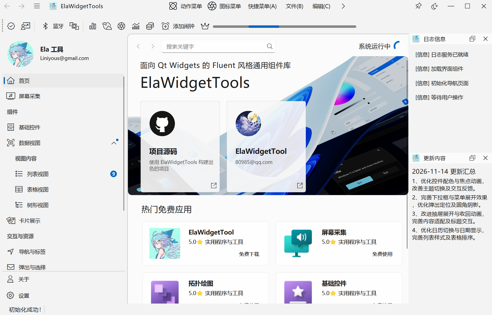
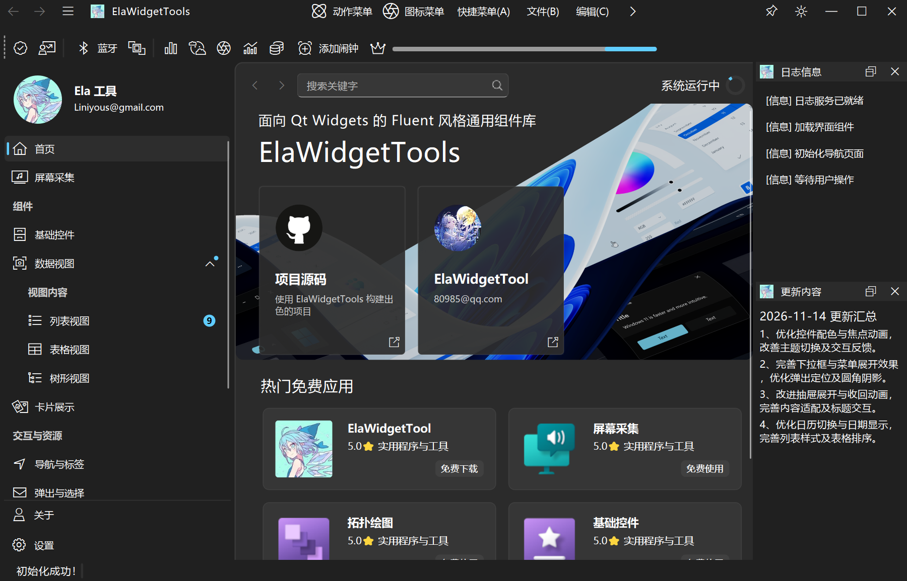
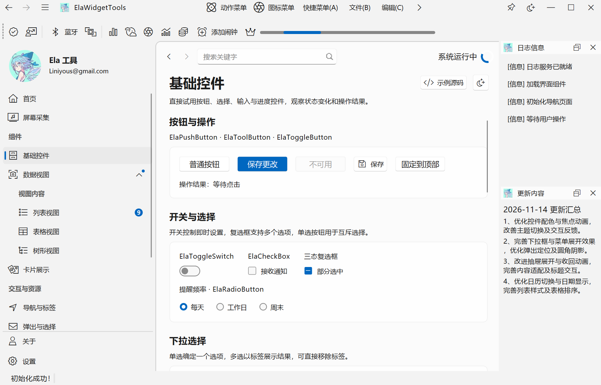
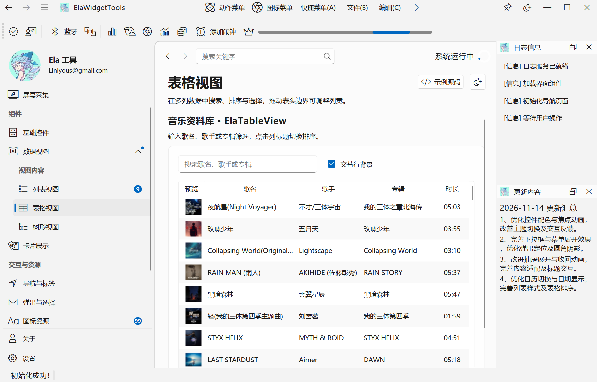

# ElaWidgetTools

## 简介

ElaWidgetTools 是基于 Qt Widgets 开发的 Fluent 风格组件库，提供统一的浅色与深色主题、无边框窗口、导航、输入控件、数据视图及交互动画，适用于桌面工具和业务应用。

项目沿用 QWidget 的布局、信号槽与 Model/View 开发方式，可通过 CMake 集成到现有 Qt 项目。仓库同时提供组件展示程序 ElaWidgetToolsExample，可直接查看控件效果与对应示例源码。

## 项目官网

> 🌐 **[访问 ElaWidgetTools 官网](https://liniyous.com)**
>
> 查阅 **API 文档** 与 **二次开发文档**，获取项目最新动态。

## 主要功能

- **窗口与导航**：无边框标题栏、侧边导航、面包屑、Ribbon、Pivot、可拖拽标签页，以及工具栏、状态栏和停靠窗口。
- **输入与选择**：按钮、开关、单选与复选框、文本输入、数字输入、下拉与多选、日期与颜色选择。
- **内容与数据**：列表、表格、树形视图、图片与交互卡片、流式布局、抽屉、进度条和进度环。
- **主题与反馈**：浅色与深色主题、全局字号、悬停与焦点动画、菜单、消息栏、教学提示和工具提示。
- **背景与工具**：跨平台 ElaMica 背景、命令式撤销与重做、事件总线、日志，以及 Windows DXGI 屏幕采集。

ElaMica 使用 Qt 图像与绘制接口实现，支持自定义背景图；它与 Windows 原生 Mica、Mica Alt、Acrylic 等显示模式分别提供。原生系统材质和 DXGI 的可用性取决于 Windows 版本与系统环境。

## 组件概览

| 分类 | 常用组件 |
| --- | --- |
| 窗口与布局 | ElaWindow、ElaWidget、ElaDialog、ElaAppBar、ElaDockWidget、ElaSplitter、ElaFlowLayout、ElaDrawerArea |
| 导航与页面 | ElaNavigationBar、ElaBreadcrumbBar、ElaRibbonBar、ElaPivot、ElaTabBar、ElaTabWidget、ElaScrollPage、ElaScrollPageArea |
| 按钮与输入 | ElaPushButton、ElaIconButton、ElaToolButton、ElaToggleButton、ElaToggleSwitch、ElaRadioButton、ElaCheckBox、ElaLineEdit、ElaPlainTextEdit、ElaSpinBox、ElaDoubleSpinBox、ElaKeyBinder |
| 选择控件 | ElaComboBox、ElaMultiSelectComboBox、ElaSuggestBox、ElaCalendar、ElaCalendarPicker、ElaColorDialog、ElaRoller、ElaRollerPicker、ElaSlider |
| 数据视图 | ElaListView、ElaTableView、ElaTreeView |
| 内容与卡片 | ElaImageCard、ElaInteractiveCard、ElaAcrylicUrlCard、ElaPopularCard、ElaPromotionCard、ElaPromotionView、ElaText |
| 提示与进度 | ElaContentDialog、ElaMessageBar、ElaMessageButton、ElaTeachingTip、ElaToolTip、ElaProgressBar、ElaProgressRing、ElaLCDNumber |
| 菜单与滚动 | ElaMenu、ElaMenuBar、ElaToolBar、ElaStatusBar、ElaScrollArea、ElaScrollBar |
| 应用工具 | ElaApplication、ElaTheme、ElaIcon、ElaEventBus、ElaActionCommander、ElaLog、ElaExponentialBlur、ElaDxgiManager |

## 最新界面

以下图片来自本仓库当前 Example 的实际运行界面，分别展示浅色主题、深色主题、基础控件与表格视图。

### 浅色主题



### 深色主题



### 基础控件



### 表格视图



截图环境：Windows、Qt 5.15.2、MSVC x64，更新于 2026-11-14。

## 近期更新

1. 优化控件配色、主题切换与焦点动画，统一列表和表格的交互反馈。
2. 完善菜单与下拉框的展开效果、贴边定位和圆角阴影，改进抽屉与日历动画。
3. 优化 ElaMica 背景缓存与跨屏绘制，处理屏幕外黑色区域及原生拖动时的动画停顿。
4. 更新组件展示程序与数据视图示例，保留本地屏幕采集，移除录制回放及网络传输依赖。

## 平台与构建环境

| 项目 | 说明 |
| --- | --- |
| 平台 | Windows、Linux；DXGI 与原生 Windows 材质仅用于 Windows |
| Qt | 推荐 Qt 5.15.2、Qt 6.6.2 / 6.6.3；具体版本限制见根目录 CMakeLists.txt |
| CMake | 3.14 或更高；Qt 6 构建还需满足相应 Qt 版本要求 |
| 编译器 | 与所选 Qt SDK 匹配的 C++ 工具链 |
| Qt 组件 | Widgets，以及相应 Qt SDK 的私有开发头文件 |
| 本次验证 | Windows、Qt 5.15.2、MSVC x64、Ninja、RelWithDebInfo |

本次更新未在 Linux 与 Qt 6 环境重新构建验证。使用其他环境时，请遵循对应 Qt SDK 的编译器与开发组件要求。

### 构建示例程序

```bash
git clone https://github.com/Liniyous/ElaWidgetTools.git
cd ElaWidgetTools
cmake -S . -B build -DQT_SDK_DIR="<Qt SDK 路径>" -DCMAKE_BUILD_TYPE=Release
cmake --build build --parallel 4
```

`QT_SDK_DIR` 应指向具体工具链对应的 Qt SDK 根目录，例如 `D:/Qt/5.15.2/msvc2019_64`。如果 Qt 已可由 CMake 找到，可省略该参数。

在 Windows 使用 MSVC 与 Ninja 时，请先进入 x64 开发者命令行；Qt Creator 或 CLion 用户也可直接选择与 Qt SDK 匹配的 Kit / 工具链。多配置生成器构建时，可追加 `--config Release`。

### 仅构建组件库

```bash
cmake -S . -B build -DQT_SDK_DIR="<Qt SDK 路径>" -DELAWIDGETTOOLS_BUILD_EXAMPLE=OFF
cmake --build build --parallel 4
```

默认构建动态库。

### 集成到现有项目

将仓库加入项目目录后，在已有 Qt 项目的 CMakeLists.txt 中链接 `Ela::WidgetTools`：

```cmake
set(ELAWIDGETTOOLS_BUILD_EXAMPLE OFF CACHE BOOL "Build the widget gallery")
add_subdirectory(third_party/ElaWidgetTools)
target_link_libraries(MyApp PRIVATE Ela::WidgetTools)
```

程序创建 `QApplication` 后，调用 `eApp->init()` 初始化字体、图标与平台支持，再创建窗口和控件：

```cpp
#include "ElaApplication.h"
#include "ElaWindow.h"

#include <QApplication>

int main(int argc, char* argv[])
{
    QApplication application(argc, argv);
    eApp->init();
    ElaWindow window;
    window.show();
    return application.exec();
}
```

### 安装

```bash
cmake --install build --prefix "<安装目录>"
```

安装后组件库提供 `ElaWidgetToolsConfig.cmake` 与 `Ela::WidgetTools` 目标。在调用方项目中使用 `find_package(ElaWidgetTools CONFIG REQUIRED)`，并在配置时指定包文件目录：

```bash
cmake -S . -B build -DElaWidgetTools_DIR="<安装目录>/ElaWidgetTools/lib/cmake" -DCMAKE_PREFIX_PATH="<Qt SDK 路径>"
```

## 示例与源码导航

| 目录 | 内容 |
| --- | --- |
| `ElaWidgetTools/` | 对外组件、接口与资源 |
| `ElaWidgetTools/private/` | PIMPL 私有实现 |
| `ElaWidgetTools/Development/` | 内部样式、模型、代理与绘制辅助实现 |
| `ElaWidgetToolsExample/ExamplePage/` | 基础控件、导航、弹出层、卡片、数据视图和屏幕采集示例 |
| `ElaWidgetToolsExample/ModelView/` | 列表、表格、树形数据模型 |
| `doc/preview/` | 当前版本的实际界面截图 |

## 反馈与交流

由于项目维护方式的原因，当前不接受 PR。如确认组件库存在问题，请提供复现步骤、操作系统、Qt 版本与工具链信息，反馈至 QQ 群：**850243692**。

## 参考范例

以下是一些使用 ElaWidgetTools 的开源项目：

- [KikoPlay：全功能弹幕播放器](https://github.com/KikoPlayProject/KikoPlay)
- [EricTool：工业级多协议数据分析平台](https://www.erictool.online/)

## 许可证

ElaWidgetTools 使用 [MIT 许可证](LICENSE)。分发源码或软件时，请保留相应的版权声明与许可证。

项目包含的第三方图标资源保留各自的来源和许可证，见 [Fluent System Icons 说明](ElaWidgetTools/Image/Fluent/SOURCE.txt) 与 [许可证](ElaWidgetTools/Image/Fluent/LICENSE.txt)。

版权所有 © 2024–2026 Liniyous。
